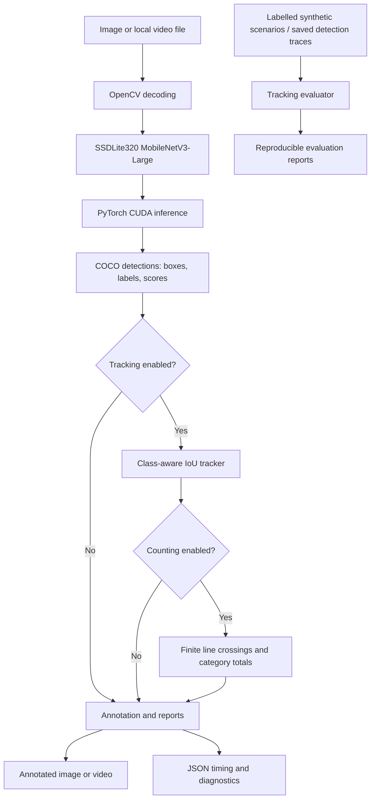

# Jetson Edge Vision

**On-device object detection, video tracking, directional counting, and reproducible evaluation on NVIDIA Jetson Orin Nano Super.**

Jetson Edge Vision is a Python computer-vision project built to explore practical **edge AI engineering**: running pretrained object detection locally on NVIDIA Jetson hardware, turning video frames into annotated results, associating detections across frames, and evaluating where tracking works—and where it fails.

The project deliberately prioritizes **measured performance, modular code, repeatable tests, and honest limitations** over unverified real-time claims.

> **Project status — Phase 4A implemented.** CUDA image/video detection, optional class-aware IoU tracking, controlled tracking evaluation, and multi-object directional line counting are implemented. **154 tests passed** with GPU integrations enabled. Live CSI camera integration, a web dashboard, region counting, and TensorRT optimization remain future work. See [Phase 4A](docs/phase4a.md) for counting verification and measured overhead.

**Explore:** [Quick start](#quick-start) · [What works](#what-works-today) · [Benchmarks](#measured-performance) · [Architecture](#architecture) · [Roadmap](#roadmap) · [Technical reports](#technical-reports)

---

## What works today

| Capability | Current implementation |
| --- | --- |
| **Image detection** | SSDLite320 MobileNetV3-Large with COCO_V1 weights; COCO labels, confidence scores, bounding boxes, annotated image output |
| **Video detection** | Sequential processing of local video files; annotated MP4/MOV/AVI output where codecs are available; JSON performance reports |
| **GPU inference** | Explicit PyTorch CUDA FP32 inference on the Jetson Orin GPU; no silent fallback to CPU |
| **Object tracking** | Optional, class-aware greedy IoU matching with session-local IDs, confirmation, missed-frame retention, and track expiration |
| **Object counting** | Optional finite virtual line, per-track hysteresis, simultaneous events, both directions, COCO category totals, annotated video and JSON events |
| **Tracking evaluation** | Deterministic synthetic scenarios, parameter sweeps, saved-detection replay, and optional trace-bound reviewed labels |
| **Reliability** | Input validation, protected output files, video-output verification, structured logging, and automated regression tests |

The pretrained model covers **80 COCO object categories**, including people, vehicles, animals, and common household items. It cannot recognize arbitrary custom categories without changing or retraining the model.

**Detection** finds objects within a frame. **Tracking** links likely matches across frames. **Counting** records qualifying line crossings by confirmed tracks; per-frame detection totals, tracking IDs, physical objects, and crossing events are different measurements. Unique physical-object counts are not inferred.

## Why this project?

A model that successfully identifies an object in one image is only the beginning of a deployable computer-vision system. Edge deployments also need predictable file handling, GPU compatibility, resource-aware processing, stable identities, trustworthy measurements, and realistic failure analysis.

Jetson Edge Vision explores those challenges on resource-constrained ARM64 hardware without requiring a cloud inference service. Its current tracker is intentionally simple, making it useful as an understandable baseline against which more advanced methods can later be compared.

## Measured performance

These are **measurements from the project’s NVIDIA Jetson Orin Nano Super**, not published model benchmarks or performance guarantees.

| Verified workload | Result | Interpretation |
| --- | --- | --- |
| Single-image FP32 inference | **151.25 ms** mean inference over 10 measured passes after 3 warm-ups | Model inference, not total image processing time |
| 48-frame video detection (854×480, 24 FPS source) | **180.13 ms** mean inference; **4.93 processing-loop FPS**; **2.52 end-to-end FPS** | End-to-end includes startup, model loading, warm-up, output encoding, and verification |
| Same 48-frame clip with Phase 3A tracking enabled | **0.1035 ms/frame** mean tracker update; **5.38 processing-loop FPS**; **2.66 end-to-end FPS** | Tracker overhead was small relative to inference; separate-run variation is not a proven speedup |
| Phase 4A line counting, same clip, two repetitions | **0.0590–0.0607 ms/frame** counting update; **5.16–5.23 loop FPS**; two person crossing events per run | Tracking-only comparison: **5.18–5.34 loop FPS**; normal timing variation exceeds any established throughput effect. [Full comparison](docs/phase4a.md) |

**Current limitation:** Processing is **slower than real-time 24 FPS playback** in these tests. GPU optimization and broader benchmarking are planned. Performance can vary with source content, system load, clocks, thermals, and configuration. See the [image](docs/phase2a.md), [video](docs/phase2b.md), and [tracking](docs/phase3a.md) reports for measurement boundaries.

### Tracking evaluation, not just a demo

Phase 3B runs **17 labelled synthetic scenarios × 27 tracker configurations × 10 repeats**, with fresh tracker state for each run. Results distinguish association errors from missed detections, category errors, and false-track behavior.

- Ordinary motion and independent objects maintained consistent IDs in controlled cases.
- An ambiguous crossing produced **two synthetic ID switches**.
- Longer track retention helped recover a seven-frame disappearance but increased stale-ID inheritance risk.
- Stronger confirmation delayed some short-lived false tracks without eliminating persistent false detections.
- Unlabelled real videos do **not** receive fabricated accuracy scores; identity-related fields remain `null` without reviewed ground truth.

The retained baseline is **IoU 0.3 / maximum missed frames 5 / minimum confirmation hits 2**. These are evaluation defaults, **not validated optimal settings** for real-world deployment. Full methods and results: [Phase 3B evaluation](docs/phase3b.md).

## Architecture



The detector is reused across image and video processing; the video pipeline loads the model once per run. Tracking and counting are opt-in and do not modify the detector. Counting processes every eligible track independently, including simultaneous crossings. The separate evaluation module can replay saved detection traces **without running CUDA inference again**. [Detailed architecture](docs/architecture.md).

## Hardware and software

This project has been **verified** on the following existing development environment—not packaged as a universal Jetson installer.

| Component | Verified environment |
| --- | --- |
| Board | NVIDIA Jetson Orin Nano Super Developer Kit (ARM64) |
| OS / Jetson Linux | Ubuntu 22.04.5 LTS / L4T R36.4.7 |
| Python | 3.10.12 |
| CUDA / GPU | CUDA 12.6 / NVIDIA Orin (`cuda:0`) |
| PyTorch / Torchvision | 2.8.0 / 0.23.0 |
| OpenCV | 4.8.0, built with GStreamer support |
| Detector | Torchvision SSDLite320 MobileNetV3-Large, `COCO_V1` pretrained weights |

**Important compatibility note:** The tested virtual environment uses a Jetson-compatible CUDA-enabled PyTorch build and reuses the host’s GStreamer-enabled OpenCV installation. A generic `pip install torch opencv-python` is **not** a verified recreation procedure and can break this particular setup. Review [environment notes](docs/environment.md) before changing libraries, JetPack, or camera drivers.

## Quick start

These instructions assume you already have a **working, compatible Jetson Python environment** containing the verified libraries above. They do not install or replace system components.

```bash
git clone https://github.com/MtshaliM11/jetson-edge-vision.git
cd jetson-edge-vision

# Activate your compatible Jetson environment. On the original development device:
source ~/jetson-projects/ai/ai-env/bin/activate

# Use the repository's src layout without installing the package:
export PYTHONPATH="$PWD/src${PYTHONPATH:+:$PYTHONPATH}"

# One-time, explicit download of the approved official model weights:
python -m jetson_edge_vision --download-weights

mkdir -p outputs
```

**The environment activation path above is specific to the original Jetson.** Use the equivalent Python environment path on your own device. The checkpoint download is explicit, verified, and kept under Git-ignored `models/`; normal inference never downloads weights automatically.

### Detect objects in an image

```bash
python -m jetson_edge_vision \
  --image /path/to/image.jpg \
  --output outputs/image-detected.jpg \
  --confidence 0.5 --warmup 3 --runs 10 \
  > outputs/image-report.json
```

### Detect objects in a video

```bash
python -m jetson_edge_vision \
  --video /path/to/video.mp4 \
  --output outputs/video-detected.mp4 \
  --confidence 0.5 --warmup 3 \
  > outputs/video-report.json
```

### Detect and track objects in a video

```bash
python -m jetson_edge_vision \
  --video /path/to/video.mp4 \
  --output outputs/video-tracked.mp4 \
  --confidence 0.5 --warmup 3 \
  --track --track-iou 0.3 --track-max-missed 5 --track-min-hits 2 \
  > outputs/tracking-report.json
```

Tracking is **off by default**. Output media is created without opening a GUI window; log messages go to stderr and machine-readable results to stdout. Choose **new output filenames** for repeated runs: the application protects existing annotated outputs from accidental replacement, although shell redirection can overwrite a JSON report.

Supported video containers include MP4, MOV, and AVI **when your installed codecs support them**. The original Jetson passed MP4/MOV `mp4v` and AVI `MJPG` encode/decode checks. Audio and original variable frame timings are not preserved in the current output pipeline. See [video processing notes](docs/phase2b.md).

### Count tracked objects crossing a line

```bash
# --count-line implies counting; --video and --track are required.
# Use new output names; noclobber also protects the redirected JSON report.
set -o noclobber
python -m jetson_edge_vision --video data/sintel-sample.mp4 --track \
  --count-line 0.4,0.1,0.4,0.9 --count-hysteresis 2 \
  --output outputs/counted.mp4 > outputs/counting-report.json
```

Coordinates are normalized. For this top-to-bottom line, right-to-left is `A->B`
and left-to-right is `B->A`. `--count` alone uses the default central line.
Confirmed consecutive observations must intersect the finite segment and leave a
2-pixel deadband on the opposite side. Missed observations break motion continuity;
ID switches and classification errors can still affect counts. See [Phase 4A](docs/phase4a.md).

### Evaluate the tracker without GPU inference

```bash
python -m jetson_edge_vision.tracking_evaluation \
  --repeats 10 \
  --output outputs/tracking-evaluation.json
```

This runs the independent synthetic evaluator. CPU replay throughput is **not** GPU video-processing FPS. See [Phase 3B](docs/phase3b.md) for saved-trace replay, trace hashes, reviewed labels, and diagnostic definitions.

## Run the tests

```bash
# Offline regression tests; GPU integrations are skipped by default:
python -m unittest discover -s tests -v

# Opt-in CUDA integrations; requires GPU access and the approved local weights:
JEV_GPU_TESTS=1 python -m unittest discover -s tests -v

# Explicit environment diagnostics:
python -m jetson_edge_vision --check-environment
```

The Phase 4A suite reported **154 passing tests with GPU integrations enabled**, preserving the original 113 tests. Default discovery reported **149 passes and five expected GPU-test skips**. The prior Phase 3B result was 113 passes with GPU enabled (109 passes and four skips by default). Some sample-specific integrations require local media paths and environment variables described in the [image](docs/phase2a.md), [video](docs/phase2b.md), and [tracking](docs/phase3a.md) reports; sample images/videos are **not included** in this repository.

## Repository layout

```text
configs/                     Default application settings
docs/                        Architecture, environment, and phase reports
src/jetson_edge_vision/
  cli.py                     Command-line interface
  detection.py               Model loading, checkpoint verification, CUDA inference
  image_pipeline.py          Image input, annotation, and timing
  video_pipeline.py          Local video processing and output validation
  tracking.py                Class-aware greedy IoU tracking
  counting.py                Independent per-track finite-line counting and events
  counting_annotation.py     Bounded counting line/totals overlay
  evaluation_scenarios.py    Labelled synthetic tracking scenarios
  tracking_evaluation.py     Independent tracking evaluator and trace replay
tests/                       Unit, regression, and opt-in GPU integration tests
pyproject.toml               Project metadata
```

The data, model checkpoints, generated videos, logs, and performance reports used during development are excluded from Git by design.

## Known limitations

- **Not yet real-time** on the tested 24 FPS clip; no TensorRT or FP16 optimization is claimed.
- **Tracking is a baseline**, not SORT, ByteTrack, or biometric identification. Occlusions, crossings, shot cuts, and category changes can cause ID switches or fragmentation.
- **Real-world tracking accuracy is unestablished** without representative, reviewed ground-truth annotations. Synthetic diagnostics are not MOTChallenge, IDF1, or HOTA scores.
- **Detection accuracy is not deployment-validated**: a 320×320 model can struggle with small objects, poor lighting, occlusion, and domain shifts.
- **No live camera mode yet.** The attached e-con Systems CSI camera has an unresolved purple/magenta colour cast; driver and ISP modifications have intentionally been deferred.
- **Counting accuracy is unvalidated on representative labelled video.** ID switches, category errors, gaps, jitter beyond the deadband, and frame sampling can affect counts.
- **No region counting, persistent event storage, API, or dashboard yet.**

## Roadmap

- [x] **Phase 1 — Foundation:** CLI, configuration, JSON logging, diagnostics, tests.
- [x] **Phase 2A — Image detection:** Pretrained COCO detector, CUDA inference, annotated output.
- [x] **Phase 2B — Video detection:** Local video processing, encoding verification, performance reporting.
- [x] **Phase 3A — Tracking:** Optional IoU-based session IDs and tracking annotations.
- [x] **Phase 3B — Evaluation:** Reproducible synthetic sweeps, trace replay, failure documentation.
- [ ] **Real-world validation:** Representative clips with reviewed identity labels before deployment claims.
- [x] **Phase 4A — Line counting:** Multi-object directional events, category totals, hysteresis, tests, and CUDA verification.
- [ ] **Further counting validation:** Reviewed real-video crossing labels and failure analysis; region counting deferred.
- [ ] **Phase 5 — CSI camera:** Live input after addressing image-quality limitations.
- [ ] **Phase 6 — Local dashboard:** API and monitoring interface.
- [ ] **Phase 7 — Optimization:** Benchmark suitable TensorRT/FP16 paths against the measured baseline.

## Technical reports

- [Architecture and module boundaries](docs/architecture.md)
- [Verified Jetson environment and safeguards](docs/environment.md)
- [Phase 2A: model selection, checkpoint, image inference, licensing](docs/phase2a.md)
- [Phase 2B: codec checks, video performance, reproducibility](docs/phase2b.md)
- [Phase 3A: tracking lifecycle and observed behavior](docs/phase3a.md)
- [Phase 3B: tracking evaluation methods, parameter sweeps, and limitations](docs/phase3b.md)
- [Phase 4A: multi-object counting, events, GPU verification, and benchmarks](docs/phase4a.md)

## Licensing and responsible use

**No project-level open-source license has been selected yet.** Public access to this repository does not itself grant permission to reuse or redistribute its code. A deliberate license decision is planned before a formal release.

Torchvision source code has a BSD-3-Clause license, but **pretrained weights may carry separate dataset-derived terms**; redistribution and commercial-use rights for the COCO_V1 checkpoint should be reviewed independently. Model weights, sample images, example videos, and generated reports are not bundled in this repository. The project is a development and evaluation prototype, not a validated safety, surveillance, or high-stakes decision system.

---

*Built and benchmarked on an NVIDIA Jetson Orin Nano Super. Development is ongoing; the measurements and limitations above describe the verified state through Phase 4A (October 2026).*
